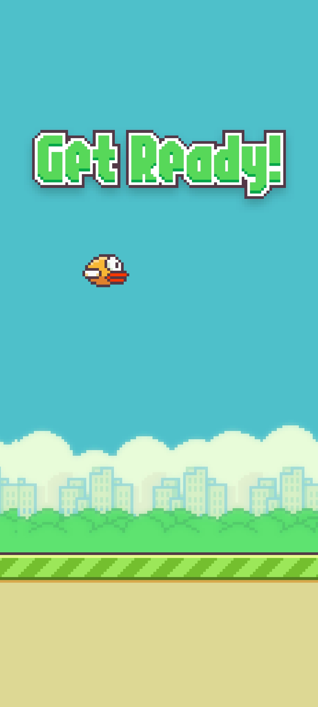
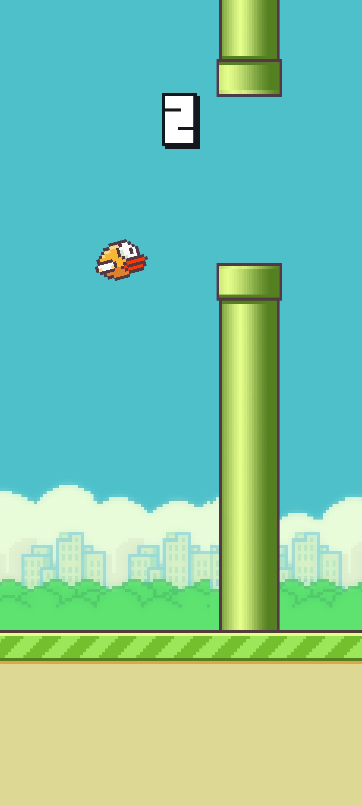
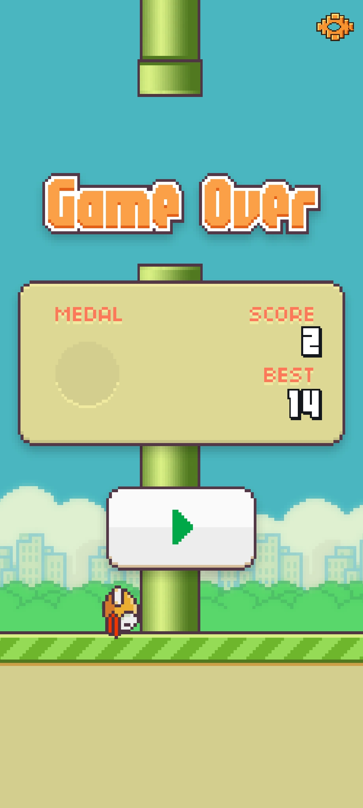
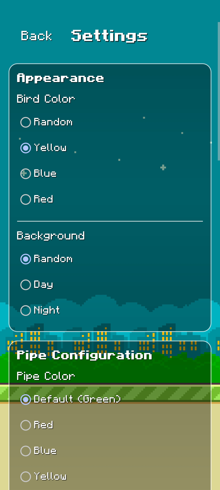
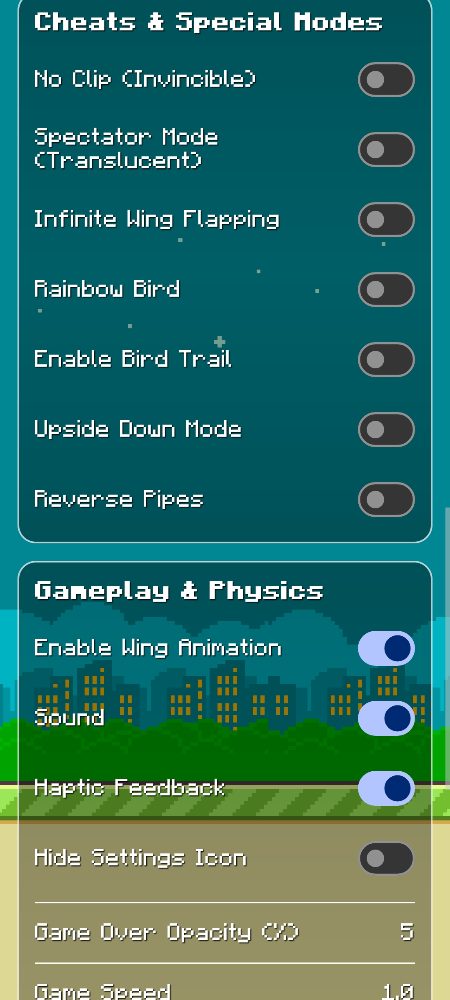
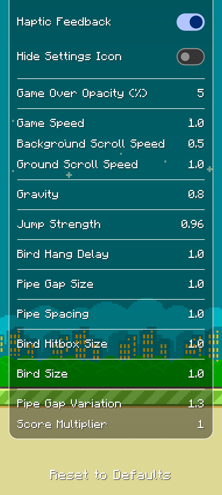

# Flappy Bird (Modern Android Edition) 🐦

The classic 2013 Flappy Bird you remember, rebuilt from the ground up to run smoothly on modern 64-bit Android devices (Android 14, 15, 16+).

No ads, no data collection, no splash screen waiting—just pure, nostalgic flapping with crisp 60 FPS physics, customizable bird skins, and a retro settings menu.

---

# 🎮 Part 1: For Gamers

## 📥 Quick Download & Play

You don't need to touch any code to play! Grab the ready-to-install game file right here:

### 👉 **[Download FlappyBird.apk](FlappyBird.apk)** *(~7.9 MB, Pre-signed & Ready)*

*(You can also download it from our [GitHub Releases](https://github.com/prabeshgupta/flappy-bird-android/releases) page).*

---

### 📲 How to Install in 3 Easy Steps

1. **Download:** Tap the download link above directly on your Android phone.
2. **Open:** Once downloaded, open your phone's **Files** or **Downloads** app and tap `FlappyBird.apk`.
3. **Install:** If your phone asks for permission to install unknown apps, tap **Allow/Settings**, then tap **Install**. Open the game and start flapping!

---

## 🕹️ In-Game Preview

Here is what the game looks like running on modern Android:

| Ready Screen | In-Flight Flapping | Game Over & High Score |
| :---: | :---: | :---: |
|  |  |  |

🎬 **Gameplay Video:** Want to see it in action? Check out the full screen recording in [`public/Screen_Recording_20261026_030443.mp4`](public/Screen_Recording_20261026_030443.mp4).

---

## ✨ What Makes This Version Awesome?

- ⚡ **Instant Start:** We bypassed the old splash screen delay. Opening the app drops you straight onto the play screen with zero wait time.
- 🧼 **Clean Home Screen:** Centered, authentic Play button without broken placeholder buttons or old copyright text cluttering the bottom.
- ⚙️ **Retro Settings Menu:** A custom pixel-art gear icon is available in the top-right corner of both the **Home Screen** and the **Game Over Screen** so you can tweak options whenever you want.

### 🎨 Themes & In-Game Customization

| Bird & World Themes | Physics & Practice Sliders | Controls & Haptics |
| :---: | :---: | :---: |
|  |  |  |

- **Bird Colors:** Choose between Classic Yellow, Red, Blue, or an animated Rainbow bird.
- **World Themes:** Switch between Day and Night backgrounds, or customize pipe colors.
- **Practice & Physics Sliders:** Having a tough time beating your high score? Adjust gravity, jump strength, pipe gaps, or bird hitbox size for casual practice.
- **Fun Extra Modes:** Toggle moving pipes, reverse pipes, ghost mode, and infinite flap.
- **Vibration & Audio:** Authentic sound effects and tactile wing flap haptic feedback. Reset everything back to default anytime with a single tap.

---

# 💻 Part 2: For Developers & Modders

This repository is a fully functional, open-source **Android Studio / Gradle** project written in clean Java.

## 📁 Project Architecture

```
flappy-bird-android/
├── FlappyBird.apk            # Prebuilt, signed working release APK (~7.9 MB)
├── build.gradle              # Top-level project Gradle build file
├── settings.gradle           # Module settings
├── gradle.properties
├── LICENSE.md
├── README.md
├── app/
│   ├── build.gradle          # App build configuration (SDK 35, 64-bit native support)
│   └── src/main/
│       ├── AndroidManifest.xml
│       ├── java/com/flappybird/recreation/
│       │   ├── MainActivity.java      # Core game engine: Choreographer loop, Canvas rendering, physics
│       │   ├── SettingsActivity.java  # Custom settings UI controller & SharedPreferences persistence
│       │   ├── GearslogoActivity.java # Splash bypass & instant transition
│       │   └── FlappyClassy.java      # Application entry class
│       └── res/              # Game audio (raw/), sprites (drawable/), and layouts
└── public/                   # Gameplay screenshots and full screen recording video
```

---

## 🚀 Getting Started with the Code

### Opening in Android Studio
1. Clone this repository:
   ```bash
   git clone https://github.com/prabeshgupta/flappy-bird-android.git
   cd flappy-bird-android
   ```
2. Open Android Studio and select **Open an Existing Project**.
3. Choose the `flappy-bird-android` directory.
4. Let Gradle sync dependencies (Java 17+ recommended).
5. Hit **Run** (`Shift + F10`) to launch directly on your device or emulator.

### Building via Terminal
```bash
# Generate a debug build
./gradlew assembleDebug

# Generate an optimized release build
./gradlew assembleRelease
```
Compiled APKs will be output to `app/build/outputs/apk/`.

---

## 🔧 Technical Fixes & Modernization

If you've tried running old 2013 Flappy Bird builds on newer Android releases, you probably ran into installation blocks or immediate crashes. Here is how this project solves those issues:

1. **64-bit ARM Support (Target SDK 35):**
   - Modern Android versions reject pure 32-bit legacy binaries. This version is built targeting modern Android API levels with full 64-bit architecture compatibility.
2. **ART Verifier Crash Fix (`VerifyError`):**
   - Fixed a Dalvik/ART type-mismatch issue where temporary registers were reused across SharedPreferences and View operations in `SettingsActivity`, causing `Class.newInstance()` to abort during activity launch.
3. **Game Over Settings Anchoring:**
   - In older decompiled mods, the settings icon was locked behind a sliding animation state (`bw != -1.0f`) and touch flag (`by:Z`), causing it to disappear or become unresponsive after dying. We anchored the icon directly to `systemBarTop + margin` so it remains visible and clickable on every screen.
4. **Defensive Null-Safety:**
   - Added null guards before querying bitmap dimensions during Choreographer frame callbacks, preventing restart crashes.

---

## 📜 Credits & License

- Original game concept, artwork, and sounds by **Dong Nguyen / dotGEARS (2013)**.
- Recreated and modernized for open-source educational preservation and retro mobile gaming on modern Android.
